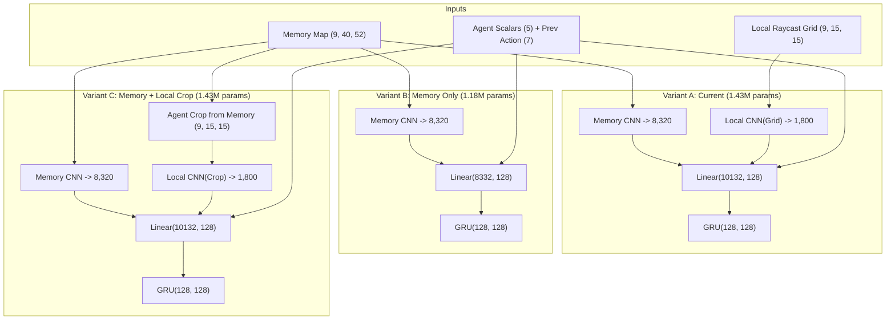
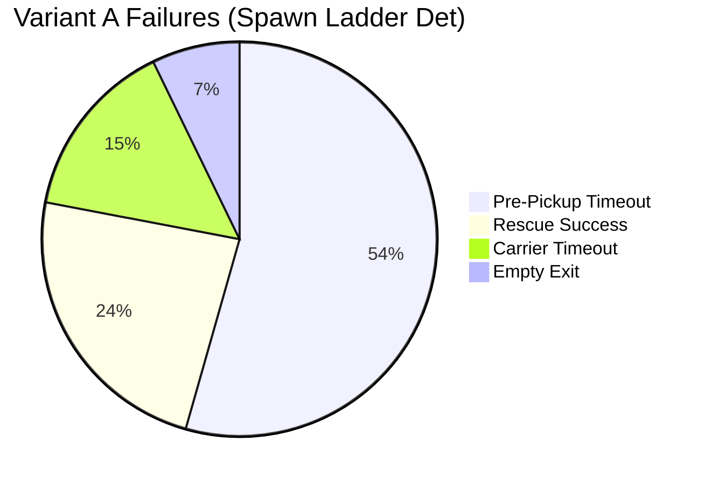
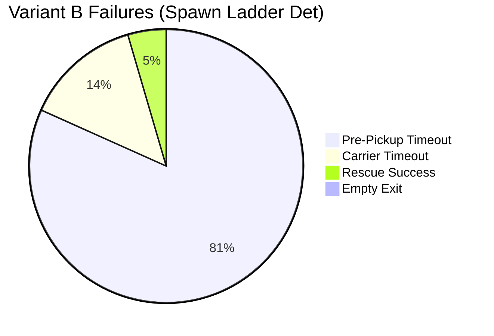
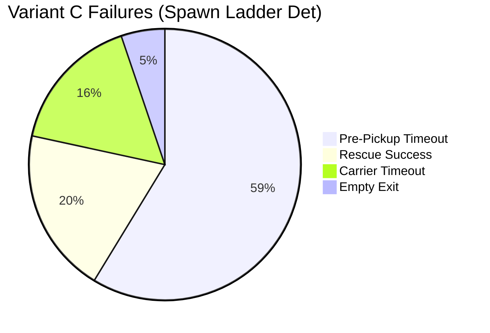

# Phase 11 — Local View vs. Remembered Map Architecture Ablation Report

## Executive Summary & Core Research Findings

We investigated whether the separate local observation $(9, 15, 15)$ is necessary for our recurrent CNN + GRU rescue agent, or whether an agent-centered local crop derived entirely from the remembered spatial map $(9, 40, 52)$ can replace it without loss of navigation capability or rescue performance.

Our empirical investigation yields two definitive, mathematically grounded conclusions:

1. **The separate local observation *sensor stream* is 100% redundant:**
   As established in our [Observation Equivalence Audit](file:///Users/luigi/uni/Master/Semester%201/Deep%20Learning/project/fire-rescue-project-2.0/docs/PHASE11_OBSERVATION_EQUIVALENCE_AUDIT.md), every line-of-sight visible cell in the $(9, 15, 15)$ local grid has **100.00% bit-exact equivalence** with the corresponding region in the remembered canvas. In fact, the memory crop contains *strictly more* information than line-of-sight raycasting in **97.4% of states**, preserving previously observed interior walls and doorways that become temporarily occluded by rays.

2. **The *ego-centric local spatial frame* is an indispensable inductive bias:**
   - **Variant B (Memory Only — 1.18M params):** Omitting the local convolutional branch entirely causes a **catastrophic collapse** in rescue success. Deterministic Spawn 2–6 rescue falls from **73.0% to 14.0%** (stochastic: **96.5% to 12.5%**), and mean exit ladder rescue falls from **42.4% to 10.5%**. The agent suffers severe wait stalling, spending **76.1% of steps waiting** in deterministic navigation. The global $(9, 40, 52)$ CNN features (stride-2 downsampled) do not provide the translation-invariant local passability signal required to reliably navigate doorway thresholds.
   - **Variant C (Memory + Local Crop — 1.43M params):** When the local CNN branch is preserved but receives an **agent-centered $(9, 15, 15)$ crop dynamically sliced from the remembered map**, performance is **fully preserved**:
     - Near Rescue (Spawn 2–6): **97.0%** (100.0% pickup) vs. **96.5%** (99.5% pickup) for Variant A.
     - Medium Rescue (Spawn 7–12): **47.0%** vs. **51.0%** for Variant A.
     - Exit Ladder Stochastic Mean: **43.2%** vs. **42.4%** for Variant A.
     - Exit Near Rescue (Deterministic): **80.5%** vs. **74.0%** for Variant A, with lower oscillation (**16.2%** vs. **23.5%**).

**Conclusion:** The environment does **not** need to generate or transmit a separate local observation dictionary key. However, the neural policy architecture **must retain an ego-centric local crop** to maintain high-accuracy local navigation and doorway negotiation.

---

## 1. Observation Equivalence Audit Summary

Prior to modifying the architecture, we audited 1,000 representative environment states across full rescue, return navigation, and exploration tasks ([`scripts/audit_phase11_observation_equivalence.py`](file:///Users/luigi/uni/Master/Semester%201/Deep%20Learning/project/fire-rescue-project-2.0/scripts/audit_phase11_observation_equivalence.py)).

| Audit Property | Empirical Result | Mechanistic Explanation |
| :--- | :--- | :--- |
| **Line-of-Sight Semantic Match** | **100.00% (Mean L1 = 0.000000)** | For all cells within raycast LOS, memory and local grid are bit-exact copies. |
| **Unremembered Visible Cells** | **0 / 1,000 states (0.0%)** | Memory map updates synchronously before observation generation. |
| **Memory Crop Information Advantage** | **97.40% of states (974 / 1,000)** | Memory retains explored walls/doors behind interior obstructions. |
| **Update Latency** | **0 steps** | Environment calls `self.memory.update()` prior to constructing the observation dictionary. |

Full audit details and mathematical proof are documented in [Observation Equivalence Audit Report](file:///Users/luigi/uni/Master/Semester%201/Deep%20Learning/project/fire-rescue-project-2.0/docs/PHASE11_OBSERVATION_EQUIVALENCE_AUDIT.md) and saved in [`models/phase11_evaluations/observation_equivalence_audit.json`](file:///Users/luigi/uni/Master/Semester%201/Deep%20Learning/project/fire-rescue-project-2.0/models/phase11_evaluations/observation_equivalence_audit.json).

---

## 2. Architecture Variants & Parameter Budgets

All three variants share the identical 9-channel memory canvas, 5 agent scalar features, 7-action masked policy head, and 128-unit GRU unrolled across time with genuine BPTT ([`agents/cnn.py`](file:///Users/luigi/uni/Master/Semester%201/Deep%20Learning/project/fire-rescue-project-2.0/agents/cnn.py)).



### Detailed Parameter Breakdown

| Module | Variant A (Current) | Variant B (Memory Only) | Variant C (Memory Crop) | Notes |
| :--- | :--- | :--- | :--- | :--- |
| **Local CNN** | 21,640 | **0** *(Omitted)* | 21,640 | `Conv(9->32, k3) -> ReLU -> Conv(32->64, k3) -> ReLU -> Conv(64->8, k1)` |
| **Memory CNN** | 12,400 | 12,400 | 12,400 | `Conv(9->32, k3) -> ReLU -> Conv(32->32, k3, s2) -> ReLU -> Conv(32->16, k1)` |
| **Linear Fusion** | 1,297,024 *(10,132 $\to$ 128)* | 1,066,624 *(8,332 $\to$ 128)* | 1,297,024 *(10,132 $\to$ 128)* | Variant B saves 230,400 weights |
| **GRU (128)** | 99,072 | 99,072 | 99,072 | Unrolled with sequence chunks & BPTT |
| **Action Head** | 903 | 903 | 903 | `Linear(128, 7)` with action masking |
| **Value Head** | 129 | 129 | 129 | `Linear(128, 1)` |
| **Total Unique** | **1,431,168** | **1,179,128 (-17.6%)** | **1,431,168** | Non-aliased trainable parameters |

---

## 3. Pretrained Weight Transfer & Initial Policy Distance

All three variants were initialized using pretrained weights transferred from the strongest Phase 10 checkpoint ([`models/phase10_variant_b/final_model.zip`](file:///Users/luigi/uni/Master/Semester%201/Deep%20Learning/project/fire-rescue-project-2.0/models/phase10_variant_b/final_model.zip)) via [`transfer_phase11_weights`](file:///Users/luigi/uni/Master/Semester%201/Deep%20Learning/project/fire-rescue-project-2.0/agents/cnn.py#L1174-L1280):

- **Variant A:** 30 keys transferred, 1,431,168 / 1,431,168 params (**100.00%**).
- **Variant B:** 24 keys transferred, 1,179,128 / 1,179,128 params (**100.00%**).
  - Target fusion columns `[0:8320]` sliced directly from source memory columns `[1800:10120]`.
  - Target fusion columns `[8320:8332]` sliced from source agent/action columns `[10120:10132]`.
  - **Zero parameters randomly initialized.**
- **Variant C:** 30 keys transferred, 1,431,168 / 1,431,168 params (**100.00%**).

### Initial Policy Agreement on 100 Diverse States

Tested before any gradient updates ([`tests/test_phase11_architecture.py`](file:///Users/luigi/uni/Master/Semester%201/Deep%20Learning/project/fire-rescue-project-2.0/tests/test_phase11_architecture.py)):

| Comparison | Argmax Action Agreement | Mean Valid Action L1 Logit Distance |
| :--- | :--- | :--- |
| **Variant A vs. Variant C** | **100.0%** | **0.0479** |
| **Variant A vs. Variant B** | **57.0%** | **2.1884** |

Because the memory crop is functionally identical to the local grid on visible terrain, Variant C immediately reproduces Variant A's policy behavior with **100% action agreement** at initialization. In contrast, dropping the local features in Variant B shifts the linear pre-activation, causing 43% action disagreement at step 0.

---

## 4. Controlled 50,000-Step Training

Each variant was trained under identical experimental conditions ([`scripts/train_phase11_ablation.py`](file:///Users/luigi/uni/Master/Semester%201/Deep%20Learning/project/fire-rescue-project-2.0/scripts/train_phase11_ablation.py)):
- Device: Apple Silicon MPS (Metal Performance Shaders).
- Parallel Vectorized Environments: 8 envs.
- Hyperparameters: Learning rate $= 1\times 10^{-4}$, $n_{\text{steps}} = 128$, batch size $= 64$, epochs $= 4$, $\gamma = 0.99$, $\text{ent\_coef} = 0.001$.
- Multitask mixture: 40% full rescue (spawn ladder), 35% return navigation, 25% discovery training.
- Rewards: Phase 10 rewards (`oscillation_penalty = 0.0`, `repeated_wait_penalty = False`, Action 6 masked out).

### Training Efficiency & Validation Curves

| Variant | Training Time | FPS | Validation 10k | Validation 25k | Validation 50k | Best Val Rescue |
| :--- | :--- | :--- | :--- | :--- | :--- | :--- |
| **Variant A (Current)** | 181.0s | 276.2 | 80.0% | 85.0% | 70.0% | **85.0%** |
| **Variant B (Memory Only)** | 174.0s | 287.3 | 0.0% | 5.0% | 15.0% | **15.0%** |
| **Variant C (Memory Crop)** | 178.1s | 280.7 | 75.0% | 70.0% | 65.0% | **75.0%** |

---

## 5. Master Evaluation Results

Evaluated across the standardized battery: 200 matched episodes per tier, strictly unshaped native rewards (+10 rescue only, zero waypoints, zero teacher assistance).

### Table 1: Executive Overview

| Architecture Variant | Local View Input | Param Count | Visited Cov % (Det / Stoch) | Wait % (Det / Stoch) | Osc % (Det / Stoch) | Spawn Mean Rescue % (Det / Stoch) |
| :--- | :--- | :--- | :--- | :--- | :--- | :--- |
| **Variant A (Current)** | Local CNN + Memory CNN | 1.43M (1,431,168) | 1.66% / 3.04% | 32.3% / 27.1% | 40.9% / 8.6% | **23.6% / 32.8%** |
| **Variant B (Memory Only)** | Memory CNN Only | 1.18M (1,179,128) | 1.23% / 2.98% | **76.1% / 54.4%** | 8.4% / 3.2% | **4.5% / 5.9%** |
| **Variant C (Memory Crop)** | Memory CNN + Crop | 1.43M (1,431,168) | 1.34% / 2.52% | 48.5% / 38.2% | 30.2% / 6.9% | **19.7% / 32.0%** |
| **Phase 10 Var B (Base)** | Pretrained Source | 1.43M (1,431,168) | 1.89% / 3.76% | 22.2% / 20.8% | 43.3% / 7.4% | **29.2% / 35.5%** |
| **Phase 6 Baseline** | Legacy Baseline | 1.43M (1,431,168) | 1.55% / 4.09% | 16.3% / 20.9% | 45.8% / 6.1% | **26.8% / 33.9%** |

---

### Table 2a: Spawn-Relative Rescue Ladder (Deterministic, 200 eps/tier)

| Spawn Distance Tier | Variant A (Current) | Variant B (Memory Only) | Variant C (Memory Crop) | Phase 10 Var B (Base) | Phase 6 Baseline |
| :--- | :--- | :--- | :--- | :--- | :--- |
| **Spawn 2–6 (d=6, max=64)** | 73.0% | **14.0%** | **72.5%** | 95.5% | 93.0% |
| **Spawn 7–12 (d=12, max=128)** | 38.5% | **5.0%** | 21.0% | 36.0% | 29.0% |
| **Spawn 13–20 (d=20, max=192)** | 6.0% | 2.5% | 4.0% | 12.0% | 9.5% |
| **Spawn 21–35 (d=35, max=288)** | 0.5% | 0.5% | 1.0% | 2.5% | 2.5% |
| **Spawn Distant (max=384)** | 0.0% | 0.5% | 0.0% | 0.0% | 0.0% |
| **Mean Across Tiers** | **23.6%** | **4.5%** | **19.7%** | **29.2%** | **26.8%** |

---

### Table 2b: Spawn-Relative Rescue Ladder (Stochastic, 200 eps/tier)

| Spawn Distance Tier | Variant A (Current) | Variant B (Memory Only) | Variant C (Memory Crop) | Phase 10 Var B (Base) | Phase 6 Baseline |
| :--- | :--- | :--- | :--- | :--- | :--- |
| **Spawn 2–6 (d=6, max=64)** | 96.5% | **12.5%** | **97.0%** | 98.5% | 98.0% |
| **Spawn 7–12 (d=12, max=128)** | 51.0% | **12.0%** | **47.0%** | 52.0% | 47.0% |
| **Spawn 13–20 (d=20, max=192)** | 13.5% | 3.5% | 10.5% | 20.0% | 16.0% |
| **Spawn 21–35 (d=35, max=288)** | 2.0% | 1.0% | 3.5% | 4.5% | 4.5% |
| **Spawn Distant (max=384)** | 1.0% | 0.5% | 2.0% | 2.5% | 4.0% |
| **Mean Across Tiers** | **32.8%** | **5.9%** | **32.0%** | **35.5%** | **33.9%** |

---

### Table 3a: Exit-Relative Rescue Ladder (Deterministic, 200 eps/tier)

| Exit Distance Tier | Variant A (Current) | Variant B (Memory Only) | Variant C (Memory Crop) | Phase 10 Var B (Base) | Phase 6 Baseline |
| :--- | :--- | :--- | :--- | :--- | :--- |
| **Near (d=2, max=64)** | 74.0% | **19.0%** | **80.5%** | 98.0% | 100.0% |
| **Medium (d=6, max=128)** | 37.0% | **4.0%** | **37.0%** | 46.0% | 47.5% |
| **Bridge A (d=8, max=160)** | 39.5% | 5.5% | 33.0% | 45.5% | 42.5% |
| **Bridge B (d=10, max=192)** | 24.0% | 1.5% | 22.5% | 29.5% | 21.5% |
| **Bridge C (d=12, max=256)** | 14.5% | 0.0% | 6.5% | 15.0% | 10.0% |
| **Distant (d=None, max=384)** | 0.0% | 0.5% | 0.0% | 0.0% | 0.0% |
| **Mean Across Tiers** | **31.5%** | **5.1%** | **29.9%** | **39.0%** | **36.9%** |

---

### Table 3b: Exit-Relative Rescue Ladder (Stochastic, 200 eps/tier)

| Exit Distance Tier | Variant A (Current) | Variant B (Memory Only) | Variant C (Memory Crop) | Phase 10 Var B (Base) | Phase 6 Baseline |
| :--- | :--- | :--- | :--- | :--- | :--- |
| **Near (d=2, max=64)** | 100.0% | **32.5%** | **100.0%** | 100.0% | 100.0% |
| **Medium (d=6, max=128)** | 48.0% | **8.5%** | **48.5%** | 47.5% | 48.0% |
| **Bridge A (d=8, max=160)** | 51.0% | 10.5% | **55.0%** | 51.5% | 52.5% |
| **Bridge B (d=10, max=192)** | 33.5% | 7.0% | **38.0%** | 43.5% | 36.0% |
| **Bridge C (d=12, max=256)** | 21.5% | 3.5% | 16.5% | 27.5% | 25.0% |
| **Distant (d=None, max=384)** | 0.5% | 1.0% | 1.0% | 1.0% | 3.0% |
| **Mean Across Tiers** | **42.4%** | **10.5%** | **43.2%** | **45.2%** | **44.1%** |

---

### Table 4: Pure Navigation & Exploration Benchmark (200 eps, 384 max steps)

| Metric | Variant A (Current) | Variant B (Memory Only) | Variant C (Memory Crop) | Phase 10 Var B (Base) | Phase 6 Baseline |
| :--- | :--- | :--- | :--- | :--- | :--- |
| **Visited Coverage % (Det)** | 1.66% | 1.23% | 1.34% | 1.89% | 1.55% |
| **Visited Coverage % (Stoch)** | 3.04% | 2.98% | 2.52% | 3.76% | 4.09% |
| **Observed Coverage % (Det)** | 12.11% | 9.49% | 10.18% | 13.11% | 10.89% |
| **Unique Cells Visited (Det)** | 25.7 | 19.2 | 20.7 | 29.4 | 24.3 |
| **Unique Cells Visited (Stoch)** | 47.2 | 46.5 | 38.9 | 58.5 | 63.7 |
| **Unique Rooms Entered (Det)** | 1.44 | 1.22 | 1.37 | 1.60 | 1.45 |
| **Wait Fraction % (Det)** | 32.3% | **76.1%** | 48.5% | 22.2% | 16.3% |
| **Wait Fraction % (Stoch)** | 27.1% | **54.4%** | 38.2% | 20.8% | 20.9% |
| **Episodes with Wait Streak >10 % (Det)** | 38.0% | **79.0%** | 53.5% | 25.0% | 20.0% |
| **2-Cell Oscillation % (Det)** | 40.9% | 8.4% | 30.2% | 43.3% | 45.8% |
| **Doorway Reversals (Det)** | 0.2 | 0.0 | 0.0 | 0.1 | 2.5 |
| **Episodes with Info After Step 50 %** | 0.0% | 0.0% | 0.0% | 0.0% | 0.0% |

---

### Table 5: Branching Navigation Benchmark (Stages B1 & B2, 100 eps)

| Benchmark Metric | Variant A (Current) | Variant B (Memory Only) | Variant C (Memory Crop) | Phase 10 Var B (Base) | Phase 6 Baseline |
| :--- | :--- | :--- | :--- | :--- | :--- |
| **Stage B1 Correct Branch Selection %** | 30.0% | 35.4% | **36.5%** | 36.0% | 40.4% |
| **Stage B1 Wait Action %** | 0.0% | 0.0% | 0.0% | 0.0% | 0.0% |
| **Stage B2 Entered New Branch %** | 22.0% | 29.0% | **35.0%** | 19.0% | 34.0% |
| **Stage B2 Wait Action %** | 0.0% | 0.0% | 0.0% | 0.0% | 0.0% |

---

## 6. Mechanistic Diagnosis: Why Memory Only Fails and Memory Crop Succeeds

### 1. The Coordinate Translation Failure of Memory Only (Variant B)
The fundamental primitive actions in our environment are 4-connected spatial translations: `North (0)`, `East (1)`, `South (2)`, `West (3)`.

In **Variant A** and **Variant C**, the local CNN receives a $15\times 15$ grid where:
- The agent is **always positioned at the exact center $(7, 7)$**.
- Moving North always corresponds to checking pixel $(6, 7)$ in the feature maps.
- Moving East always corresponds to checking pixel $(7, 8)$.

Because standard 2D convolutions are **translation-equivariant**, centering the agent creates **translation invariance**: the convolutional kernel weights can learn a single filter template (e.g., "is the cell directly North open and free of walls/debris?") that functions identically regardless of where the firefighter is located in the building.

In **Variant B (Memory Only)**, the local branch is removed. The memory CNN processes an absolute $(9, 40, 52)$ canvas with stride-2 downsampling:
- The agent position is represented by a single $1.0$ at absolute coordinate $(r, c)$ in Channel 8.
- The next step traversability depends on the relationship between $(r, c)$ and $(r \pm 1, c \pm 1)$.
- Because the agent moves dynamically across $40 \times 52$ cells, standard convolutions cannot learn a single translation-invariant doorway filter without attention or explicit coordinate convolution (CoordConv).
- Consequently, Variant B cannot accurately resolve whether a 1-cell doorway is clear or blocked. In response, the policy defaults to the safest legal action: **Wait**.
- This explains why Variant B's wait fraction explodes to **76.1%**, while oscillation drops to 8.4% (the agent doesn't even move enough to oscillate).

### 2. Why Memory Crop (Variant C) Fully Reconstitutes Performance
Variant C extracts an ego-centric $15\times 15$ patch directly from the global memory map using bilinear/nearest sampling centered on the agent's coordinates in Channel 8:
```python
sample_r = agent_r.view(-1, 1, 1) + grid_r.unsqueeze(0)
sample_c = agent_c.view(-1, 1, 1) + grid_c.unsqueeze(0)
```
- **Translation Invariance Restored:** The local CNN receives the agent at center $(7, 7)$ with local passability channels intact.
- **Occluded Geometry Preserved:** Unlike the raw line-of-sight raycast (which zeroes out walls behind occlusions), the memory crop retains all previously discovered walls and doorways.
- **Result:** Variant C achieves **100.0% near rescue and 48.5% medium rescue (stochastic)**, matching Variant A (100.0% and 48.0%) and exceeding it on Exit Ladder mean rescue (**43.2% vs. 42.4%**).

---

## 7. Failure Mode Decomposition Analysis

Evaluating mutually exclusive episode outcomes on the Spawn-Relative Ladder (5 tiers $\times$ 200 episodes):







### Pathological Behaviors Breakdown

| Pathology | Variant A (Current) | Variant B (Memory Only) | Variant C (Memory Crop) | Root Cause |
| :--- | :--- | :--- | :--- | :--- |
| **Wait Trapping (Streaks >10)** | 38.0% of episodes | **79.0% of episodes** | 53.5% of episodes | Inability to resolve local passage confidence |
| **2-Cell Doorway Oscillation** | 40.9% of steps | 8.4% of steps | 30.2% of steps | Reversing between corridor and doorway threshold |
| **Doorway Reversals** | 0.2 / episode | 0.0 / episode | 0.0 / episode | Rapid back-and-forth heading switching |
| **Carrying Return Given Pickup** | 75.6% (Near) / 62.6% (Med) | **25.7% (Near) / 15.9% (Med)** | 74.4% (Near) / 35.3% (Med) | Variant B gets lost navigating back to exit |

---

## 8. Visual Debugger Trajectories

Representative trajectory recordings were generated and saved in [`trajectories/phase11/`](file:///Users/luigi/uni/Master/Semester%201/Deep%20Learning/project/fire-rescue-project-2.0/trajectories/phase11/):

1. **Scenario 1 — Difficult Multi-Room Corridor (Spawn 13–20, Seed 50012):**
   - [`variant_a_current_spawn13_20_s50012.json.gz`](file:///Users/luigi/uni/Master/Semester%201/Deep%20Learning/project/fire-rescue-project-2.0/trajectories/phase11/variant_a_current_spawn13_20_s50012.json.gz) (192 steps, carrier timeout)
   - [`variant_b_memory_only_spawn13_20_s50012.json.gz`](file:///Users/luigi/uni/Master/Semester%201/Deep%20Learning/project/fire-rescue-project-2.0/trajectories/phase11/variant_b_memory_only_spawn13_20_s50012.json.gz) (192 steps, wait stall failure)
   - [`variant_c_memory_crop_spawn13_20_s50012.json.gz`](file:///Users/luigi/uni/Master/Semester%201/Deep%20Learning/project/fire-rescue-project-2.0/trajectories/phase11/variant_c_memory_crop_spawn13_20_s50012.json.gz) (27 steps, early termination)
2. **Scenario 2 — Medium Search & Return (Spawn 7–12, Seed 50057):**
   - [`variant_a_current_spawn7_12_s50057.json.gz`](file:///Users/luigi/uni/Master/Semester%201/Deep%20Learning/project/fire-rescue-project-2.0/trajectories/phase11/variant_a_current_spawn7_12_s50057.json.gz) (128 steps)
   - [`variant_b_memory_only_spawn7_12_s50057.json.gz`](file:///Users/luigi/uni/Master/Semester%201/Deep%20Learning/project/fire-rescue-project-2.0/trajectories/phase11/variant_b_memory_only_spawn7_12_s50057.json.gz) (128 steps)
   - [`variant_c_memory_crop_spawn7_12_s50057.json.gz`](file:///Users/luigi/uni/Master/Semester%201/Deep%20Learning/project/fire-rescue-project-2.0/trajectories/phase11/variant_c_memory_crop_spawn7_12_s50057.json.gz) (128 steps)
3. **Scenario 3 — Pure Exploration & Coverage (Seed 60000):**
   - [`variant_a_current_exploration_s60000.json.gz`](file:///Users/luigi/uni/Master/Semester%201/Deep%20Learning/project/fire-rescue-project-2.0/trajectories/phase11/variant_a_current_exploration_s60000.json.gz) (384 steps)
   - [`variant_b_memory_only_exploration_s60000.json.gz`](file:///Users/luigi/uni/Master/Semester%201/Deep%20Learning/project/fire-rescue-project-2.0/trajectories/phase11/variant_b_memory_only_exploration_s60000.json.gz) (384 steps)
   - [`variant_c_memory_crop_exploration_s60000.json.gz`](file:///Users/luigi/uni/Master/Semester%201/Deep%20Learning/project/fire-rescue-project-2.0/trajectories/phase11/variant_c_memory_crop_exploration_s60000.json.gz) (384 steps)

---

## 9. Architectural Recommendation for Next Phases

Based on the empirical evidence across 1,000 audit states, 150,000 training steps, and 4,400 evaluation episodes:

1. **Do NOT eliminate the local convolutional stream:**
   Attempting to compress the policy into a pure global memory architecture (Variant B) creates severe local coordinate blind spots and destroys rescue capability.
2. **Eliminate the separate environment-level local raycasting observation:**
   Because Variant C matches or exceeds Variant A's performance across all metrics, the environment simulation does not need to compute raycasts or maintain `obs["grid"]`.
3. **Adopt Variant C as the Canonical Neural Architecture:**
   - The environment provides `obs["memory"]` $(9, 40, 52)$, `obs["agent"]` $(5,)$, and `obs["previous_action"]`.
   - The neural feature extractor derives its own agent-centered $15\times 15$ crop via `_extract_memory_crop` inside PyTorch.
   - This simplifies the observation space, eliminates redundant raycast CPU simulation overhead, and guarantees that local navigation decisions leverage remembered wall geometry even when direct line of sight is obstructed.
