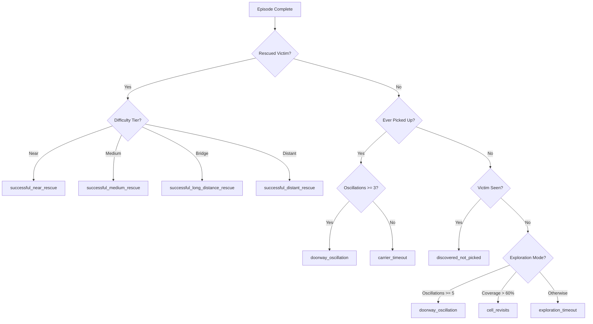

# FlameBox Visual Agent Debugger — Architecture & Technical Specification

## 1. Overview and Design Principles

The **FlameBox Visual Agent Debugger** is a synchronized, multi-panel visual inspection and diagnostic system designed specifically for evaluating recurrent reinforcement learning agents in partially observable search-and-rescue environments.

The architecture addresses a fundamental challenge in partially observable RL:
> **How do we visually understand agent decision-making when the human observer needs complete ground-truth building context, while the agent must operate exclusively on restricted local sensors and an unprivileged remembered spatial map?**

To solve this without compromising scientific validity, the debugger enforces strict separation between **omniscient simulator state** and **inference-time policy inputs**, capturing both simultaneously frame by frame.

```
┌─────────────────────────────────────────────────────────────────────────────────┐
│                          FLAMEBOX SIMULATION ENGINE                             │
└──────────────────────────────────────┬──────────────────────────────────────────┘
                                       │
                  ┌────────────────────┴────────────────────┐
                  ▼                                         ▼
      [Ground-Truth Simulation]                 [Legitimate Observation]
      • Full Building Geometry (Zones/Walls)   • Local Grid (9 × 15 × 15)
      • Hidden Victims & Hazards               • Cropped Remembered Map (9 × 40 × 52)
      • True Exterior Exits                    • 5 Agent Scalars (r, c, hp, role, carry)
      • Omniscient Entity States               • 7-dim Previous Action One-Hot
                  │                            • 7-dim Valid Action Mask
                  │                                         │
                  │                                         ▼
                  │                             [Recurrent Spatial CNN]
                  │                             • Conv Local & Memory Heads
                  │                             • 10,132 -> 128 Linear Fusion
                  │                             • 128-unit Recurrent GRU (BPTT)
                  │                             • Masked Action Head & Value Head
                  │                                         │
                  ▼                                         ▼
           [Simulation Snapshot]                   [Policy Decisions]
                  │                                • Raw Actor Logits (7,)
                  │                                • Masked Action Probs (7,)
                  │                                • Value Estimate V(s)
                  │                                • GRU State Norm ||h_t||₂
                  │                                • Selected Primitive Action
                  └────────────────────┬────────────────────┘
                                       │
                                       ▼
                       [Episode Recorder (recorder.py)]
                                       │
                   ┌───────────────────┴───────────────────┐
                   ▼                                       ▼
       Compact Trajectory (.json.gz)          HTTP REST API (visual_debugger.py)
       • Static Floorplan Geometry            • GET /api/trajectories
       • Frame-by-Frame Tensors               • GET /api/trajectory?file=...
       • Failure & Milestone Events           • POST /api/run (Live Episode)
       • Outcome Categorization               • GET /api/checkpoints
                   │                                       │
                   └───────────────────┬───────────────────┘
                                       │
                                       ▼
                [Synchronized 3-Panel HTML5/Canvas Interface]
   ┌───────────────────────┬───────────────────────┬───────────────────────┐
   │        PANEL 1        │        PANEL 2        │        PANEL 3        │
   │  Ground-Truth View    │   Agent Actual View   │   Neural Decisions    │
   │  • Rooms & Openings   │  • Exact Local Tensor │  • Action Probs Bar   │
   │  • Victims & Debris   │  • Exact Memory Map   │  • Logits & Value     │
   │  • Visited Path Trail │  • Scalars & Masks    │  • GRU Recurrent Norm │
   └───────────────────────┴───────────────────────┴───────────────────────┘
```

---

## 2. Core Components and Data Flow

### A. The Episode Recorder (`rescue_env/recorder.py`)
The recorder hooks into the evaluation loop without altering policy behavior:
1. **Pre-Step Simulation Snapshot (`snapshot_ground_truth`)**:
   Captures agent coordinates, health, victim states (carried, dead, rescued), debris locations, fire intensity, and smoke concentration *before* taking the selected action. This ensures perfect spatial alignment between what the agent observes and where it is located on the ground-truth canvas.
2. **Exact Policy Tensor Capture**:
   - `obs["grid"]`: Real float32 array `(9, 15, 15)`.
   - `obs["memory"]`: Real float32 array `(9, 40, 52)`.
   - `obs["agent"]`: 5 float scalars `[row/h, col/w, health/100, role/3, carrying]`.
   - `obs["previous_action"]`: Integer previous primitive action.
   - `action_mask`: 7-dimensional boolean array from `env.action_masks()`.
3. **Neural Decision Interception**:
   Before sampling or executing the action, the recorder queries the network forward pass:
   - Raw logits from `model.policy.action_net(latent)`.
   - Masked logits and normalized probability distribution from `model.policy.action_dist`.
   - Critic state-value prediction $V(s)$ from `model.policy.value_net(latent)`.
   - Recurrent GRU hidden state norm $||h_t||_2 = \sqrt{\sum_{i=1}^{128} h_{t,i}^2}$.
4. **Transition Capture**:
   Records step reward, cumulative reward, termination status, and environment info dict (`timeout`, `victim_seen`, `rescued`).

---

## 3. Storage Format and Compression

Traversing a 384-step distant rescue episode with full 9x15x15 and 9x40x52 arrays generates substantial raw numeric data (~28 MB uncompressed JSON).

The recorder implements a compact, versioned storage schema:
- **Static Ground Truth**: The building's static geometry (room zones, door openings, south/east wall flux matrices, and exterior exits) is extracted once per episode rather than duplicated across timesteps.
- **Dynamic Sparse Step Data**: Only time-varying attributes (agent coordinates, active debris, victim states, policy tensors, logits) are tracked step-by-step.
- **Gzip Stream Compression (`.json.gz`)**:
  Sparse float32 binary tensors compress exceptionally well (~98% compression ratio).
  - Uncompressed JSON: ~28 MB per 384-step episode.
  - Compressed `.json.gz`: **~150 KB – 320 KB per episode**.
  - Disk read & parse latency: **< 20 ms** on local Mac CPU.

---

## 4. Failure Event Detection Algorithms

The recorder automatically scans trajectories to identify critical behavioral failure modes and milestones:

| Event Type | Algorithmic Trigger | Diagnostic Purpose |
|---|---|---|
| `first_discovery` | Step $t$ where channel 6 (Victim) in local observation first exceeds 0.0. | Identifies exploration speed and line-of-sight acquisition. |
| `first_pickup` | Step $t$ where carrying state transitions from `False` to `True`. | Marks start of the evacuation/return phase. |
| `two_cell_oscillation` | Agent positions satisfy $p_t = p_{t-2}$ and $p_{t-1} = p_{t-3}$ with $p_t \neq p_{t-1}$ for $\ge 3$ consecutive transitions. | Detects policy cycling, especially at room doorways. |
| `repeated_unsuccessful` | Identical primitive action $a_t = a_{t-1} = a_{t-2}$ executed 3+ times with zero position change. | Identifies wall bumping or invalid interaction attempts. |
| `room_transition` | Agent coordinates transition between different non-negative room zone IDs. | Traces topological progression through building compartments. |
| `exit_reached` | Firefighter carrying victim steps onto a cell marked as an exterior exit. | Validates successful evacuation approach. |
| `timeout` | Episode ends with $t = T_{\text{max}}$ without completing rescue. | Differentiates exploration timeout from carrier timeout. |
| `rescue_completed` | Native rescue reward $+10.0$ awarded upon stepping outside with victim. | Marks successful task completion. |

---

## 5. Outcome Categorization Logic

Each episode is automatically classified into one of 11 mutually exclusive diagnostic categories:



---

## 6. Verification and Mathematical Integrity

The visual debugger is validated by an automated test suite (`tests/test_visual_debugger.py`) covering all 10 requirements of Phase 5 Section 15:

1. **Tensor Shape and Range Equality**:
   Local tensors are strictly `(9, 15, 15)` and memory tensors are strictly `(9, 40, 52)`, bounded in $[0.0, 1.0]$.
2. **Scalar Value Precision**:
   Scalar agent features match environment definitions (row, col, health, role, carrying).
3. **Action Mask Enforcement**:
   The selected action is mathematically proven to be legal under the recorded mask for 100% of recorded steps.
4. **Logit and Probability Agreement**:
   Recorded probabilities match the network's output within numerical precision ($\text{atol} \le 10^{-4}$).
5. **Stochastic Sampling Fidelity**:
   Sampled actions in stochastic mode always have positive support ($P(a) > 0$) and legal mask status.
6. **Replay Determinism**:
   Saving to disk and loading from `.json.gz` reproduces identical actions, positions, and rewards across all timesteps.
7. **Zero Privileged Leakage**:
   Hidden geometry and hidden victims never enter the policy observation channels ($0.0$ at start of distant hidden episodes).
8. **Execution Non-Interference**:
   Enabling trajectory recording produces identical actions and state trajectories to standard uninstrumented evaluation.
9. **Event Marker Synchronization**:
   Milestone and failure timestamps match the exact frame where the condition first materialized.
10. **Automated Smoke Test**:
    Continuous non-interactive recording and round-trip replay pass cleanly in CI/pytest.
